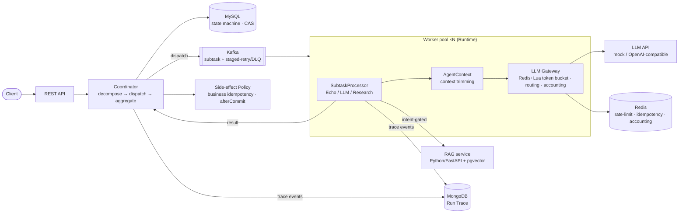

# AgentFlow

**A distributed multi-agent task orchestration platform** — decomposes complex tasks into
sub-task DAGs, dispatches them over Kafka to a horizontally-scalable worker pool running
LLM agents, with self-built idempotency, staged-retry/DLQ, a cost-aware LLM gateway, execution
tracing, and a unified idempotent side-effect policy.

> 中文文档见 [`README.md`](README.md) · 设计文档 [`docs/specs/2026-07-11-agentflow-design.md`](docs/specs/2026-07-11-agentflow-design.md)

Positioning keywords: **controllable · operable · observable/traceable · recoverable · idempotent**
— an *infra for controllable, operable workflow agents*, not an autonomous black box.

---

## Architecture

**Harness (control plane)** owns orchestration, state, reliability, observability and side-effects.
**Runtime (execution plane)** only "thinks and acts" — every side-effect and persistence flows back
to the Harness through the Policy layer. Full diagram: [`docs/architecture.md`](docs/architecture.md).



**Polyglot persistence** (right store per access pattern): MySQL (transactional state machine) ·
Kafka (durable partitioned queue, replayable) · Redis (locks/rate-limit/accounting/idempotency) ·
MongoDB (nested-JSON execution traces) · pgvector (ANN vector search).

---

## Self-built core (résumé highlights)

1. **Coordinator + state machine** — DAG decomposition, **partial-failure semantics**
   (`PARTIAL_FAILED`), DB compare-and-swap transitions, timeout sweeper.
2. **Kafka reliability layer** — self-built **staged delay-retry topics (5s/30s/5m) + DLQ + replay**
   (Kafka has no native delay/DLQ; built on top, comparable to RocketMQ semantics).
3. **Cost-aware LLM gateway** — **Redis + Lua token-bucket** rate limiting (atomic, shared across
   workers), multi-model routing, token accounting — the single choke-point for all LLM calls.
4. **Run Trace** — event-sourced through Kafka → MongoDB; full lifecycle is auditable/replayable
   to prove a task closed the loop (`SUBMITTED → … → TASK_FINALIZED`).
5. **Unified side-effect Policy** — every side-effect goes through one gate with business-level
   idempotency, fired `afterCommit`; enforced structurally in code, not by prompt.

Plus **AgentContext** (token-budget context trimming to prevent context bloat), **dynamic Skill
registry** (Spring-collected, schema-constrained output so the model can't free-wheel, multi-hit
priority ordering), and an **intent-driven RAG tool** (retrieve only when intent warrants it).

---

## Measured metrics

Environment: Apple M5 (10 cores) · JDK 21 · all middleware in Docker · **mock LLM** (load-testing
the scheduler, not the model — free & deterministic). Reproduce: `scripts/load_test.py`.

| Metric | Result |
|---|---|
| Throughput / latency (3 workers) | submit P50 40ms / P99 137ms; **end-to-end** P50 5.3s / P99 6.9s; 103 tasks/min; 8.6 subtasks/s |
| Horizontal scaling 1→3 workers | 3.1 → 8.6 subtasks/s = **2.77×** (single-machine resource bound, not architectural) |
| Cost control (idempotency) | crash scenario: **27.3%** of redeliveries intercepted (no duplicate LLM calls) |
| Fault tolerance | `kill -9` a worker mid-load → **24/24 tasks still COMPLETED** (zero loss) |
| Retrieval quality | mean **Recall@3 = 1.0** (deterministic embedding) |
| Side-effect idempotency | 85 finalized tasks → **85 notifications, 0 duplicates** |
| Observability | Run Trace completeness **100%** |

> Absolute numbers are machine-specific; the architectural conclusions are the **relative** ones
> (scaling ratio, interception rate, zero-loss, 100% trace completeness).

---

## Quick start

```bash
# 1. middleware (MySQL / Redis / Kafka(KRaft) / MongoDB / pgvector)
docker compose up -d
docker run -d --name agentflow-pgvector -p 5433:5432 \
  -e POSTGRES_PASSWORD=agentflow -e POSTGRES_DB=agentflow_rag pgvector/pgvector:pg16

# 2. server + worker (mock LLM by default — no API key, no cost)
mvn -q -f agentflow-server/pom.xml spring-boot:run     # terminal A  (:8080)
mvn -q -f agentflow-worker/pom.xml spring-boot:run     # terminal B  (scale: run N)

# 3. RAG service (for RESEARCH_BATCH)
cd agentflow-rag && python3 -m venv .venv && .venv/bin/pip install -r requirements.txt && ./run.sh  # :8000
```

**Web console** — open `http://localhost:8080/` (single-file dashboard: submit tasks, live progress,
Run Trace timeline, LLM token accounting). See screenshot below.

Submit via API:

```bash
curl -X POST localhost:8080/api/v1/tasks -H 'Content-Type: application/json' \
  -d '{"type":"LLM_BATCH","payload":{"items":["text A","text B"],"model":"mock-small"}}'
# GET /api/v1/tasks/{uuid}        -> status + progress + aggregated result
# GET /api/v1/tasks/{uuid}/trace  -> full execution trace
# GET /api/v1/llm/usage           -> token accounting per model
```

Task types: `ECHO_BATCH` (echo, for load tests) · `LLM_BATCH` (LLM summarize via gateway) ·
`RESEARCH_BATCH` (intent-gated RAG retrieval → summarize).

> Demo asset: run the console and record a GIF / screenshot for the repo header (verified working —
> submit → live progress → Run Trace timeline `SUBMITTED → … → TASK_FINALIZED` → token accounting).

---

## Tech stack

Java 17 · Spring Boot 3 · Kafka (KRaft) · Redis/Redisson · MySQL · MongoDB · pgvector ·
Python 3 / FastAPI (RAG microservice) · JDK HttpClient (LLM/RAG clients, no SDK bloat) ·
Docker Compose. Tests: **85 Java + 6 Python**, integration tests hit real middleware.

## Why not Temporal / LangGraph?

The core scheduler is self-built on purpose — to demonstrate distributed-systems design rather than
framework usage, and to keep every component explainable from principle to implementation. The
agent's inner LLM loop is where off-the-shelf pieces are fine; the orchestration/reliability layer
is the moat.

## Roadmap

- [x] W1–8: skeleton → reliability & observability → LLM gateway & controllable agent → RAG &
  multi-role → load test & fault drill (all 7 metrics measured) + Web console
- [ ] W9 (optional add-ons): cloud deploy (GCP/AWS free tier), Prometheus metrics, Zookeeper
  leader-election/registration
- [ ] W10: résumé bullets finalized (see [`docs/resume-bullets.md`](docs/resume-bullets.md))
