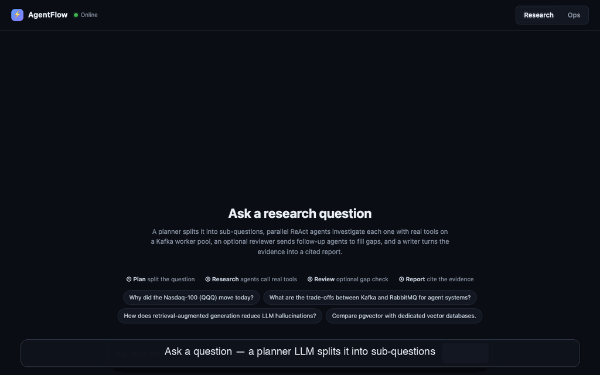
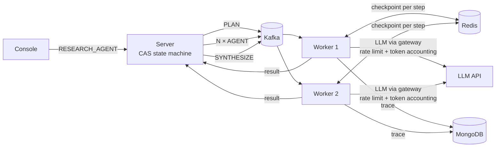
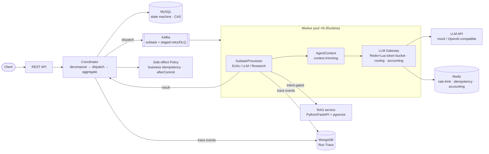

# AgentFlow

[](https://github.com/congfanpu-lgtm/agentflow/actions/workflows/ci.yml)
· [中文](README.zh.md) · design doc [`docs/specs/2026-07-11-agentflow-design.md`](docs/specs/2026-07-11-agentflow-design.md)

**A crash-tolerant multi-agent research system on a Kafka worker pool.** Ask a question → a planner LLM splits it
into sub-questions → each sub-question is researched in parallel by a ReAct agent (native tool calling:
Wikipedia, web fetch, local RAG) → a final LLM writes a report with verified citations.
Kill a worker mid-run and the agent resumes on another worker **from its last checkpointed step, without
re-running tools**.

<!--  -->

```bash
cp .env.example .env          # default: mock LLM (no key, no cost). Set LLM_PROVIDER=openai + key for a real model
docker compose up -d --build --wait
open http://localhost:8080    # click an example question
scripts/chaos-agent.sh        # kill a worker mid-run, watch the agent resume
```



**How a research task runs**

| Stage | Subtasks | What happens |
|---|---|---|
| ① Plan | 1 | LLM splits the question into 2–4 sub-questions (schema-validated) |
| ② Agents | N, in parallel | ReAct loop, max 6 steps; each step checkpointed to Redis; tools are read-only |
| ③ Synthesize | 1 | LLM writes the report; citations limited to URLs tools actually returned |

Every stage is an ordinary Kafka subtask, so it inherits the existing reliability layer: staged retries
(5s/30s/5m) → DLQ with replay, timeout sweep, idempotency guard, partial-failure semantics, full run trace.

> ⚠️ No authentication. Keep it on localhost / a private network; add auth before exposing it publicly,
> especially with a real LLM key configured.

Positioning keywords: **controllable · operable · observable/traceable · recoverable · idempotent**
— an *infra for controllable, operable workflow agents*, not an autonomous black box.

---

## Architecture

**Harness (control plane)** owns orchestration, state, reliability, observability and side-effects.
**Runtime (execution plane)** only "thinks and acts" — every side-effect and persistence flows back
to the Harness through the Policy layer. Full diagram: [`docs/architecture.md`](docs/architecture.md).



**Polyglot persistence** (right store per access pattern): MySQL (transactional state machine) ·
Kafka (durable partitioned queue, replayable) · Redis (locks/rate-limit/accounting/idempotency) ·
MongoDB (nested-JSON execution traces) · pgvector (ANN vector search).

---

## Self-built core (résumé highlights)

- **Resumable ReAct agents** — native OpenAI tool calling; per-step checkpoint in Redis keyed by subtask UUID;
  on redelivery (worker crash, retry, timeout sweep) the agent replays saved steps and continues — tools are never re-run.
  At-least-once delivery + read-only tools ⇒ effectively exactly-once tool side effects.
- **Multi-stage orchestration** — plan → map → reduce built on the same subtask state machine; the next stage is
  created in the same DB transaction that settles the last result (row lock on the task counter ⇒ created exactly once),
  dispatched after commit.
- **Agent guardrails** — SSRF guard on `web_fetch` (blocks loopback/private/link-local/CGNAT, re-checked on every redirect);
  tool errors fed back to the model instead of crashing; duplicate-call cache; fabricated citations dropped and traced.

1. **Coordinator + state machine** — DAG decomposition, **partial-failure semantics**
   (`PARTIAL_FAILED`), DB compare-and-swap transitions, timeout sweeper.
2. **Kafka reliability layer** — self-built **staged delay-retry topics (5s/30s/5m) + DLQ + replay**
   (Kafka has no native delay/DLQ; built on top, comparable to RocketMQ semantics).
3. **Cost-aware LLM gateway** — **Redis + Lua token-bucket** rate limiting (atomic, shared across
   workers), multi-model routing, token accounting — the single choke-point for all LLM calls.
4. **Run Trace** — event-sourced through Kafka → MongoDB; full lifecycle is auditable/replayable
   to prove a task closed the loop (`SUBMITTED → … → TASK_FINALIZED`).
5. **Unified side-effect Policy** — every side-effect goes through one gate with business-level
   idempotency, fired `afterCommit`; enforced structurally in code, not by prompt.

Plus **AgentContext** (token-budget context trimming to prevent context bloat), **dynamic Skill
registry** (Spring-collected, schema-constrained output so the model can't free-wheel, multi-hit
priority ordering), and an **intent-driven RAG tool** (retrieve only when intent warrants it).

---

## Measured metrics

Environment: Apple M5 (10 cores) · JDK 21 · all middleware in Docker · **mock LLM** (load-testing
the scheduler, not the model — free & deterministic). Reproduce: `scripts/load_test.py`.

| Metric | Result |
|---|---|
| Throughput / latency (3 workers) | submit P50 40ms / P99 137ms; **end-to-end** P50 5.3s / P99 6.9s; 103 tasks/min; 8.6 subtasks/s |
| Horizontal scaling 1→3 workers | 3.1 → 8.6 subtasks/s = **2.77×** (single-machine resource bound, not architectural) |
| Cost control (idempotency) | crash scenario: **27.3%** of redeliveries intercepted (no duplicate LLM calls) |
| Fault tolerance | `kill -9` a worker mid-load → **24/24 tasks still COMPLETED** (zero loss) |
| Retrieval quality | mean **Recall@3 = 1.0** (deterministic embedding) |
| Side-effect idempotency | 85 finalized tasks → **85 notifications, 0 duplicates** |
| Observability | Run Trace completeness **100%** |

> Absolute numbers are machine-specific; the architectural conclusions are the **relative** ones
> (scaling ratio, interception rate, zero-loss, 100% trace completeness).

---

## Research-agent evaluation

`eval/run_eval.py` runs 20 fixed questions (EN + ZH; current events, systems, comparisons, ML concepts)
through the real stack and scores the reports. A judge model (Claude Sonnet) grades each question's
required aspects 0/1/2, and **checks citations against the cited page itself**: it samples cited sentences,
fetches the source URL, and asks whether that page supports the sentence. Model under test: Claude Haiku.
Full per-question tables: [`eval/results/`](eval/results/).

| Run | What changed | Citation accuracy (strict / lenient) | Depth | Agents with no sources | Cost / question | p50 |
|---|---|---|---|---|---|---|
| v2-noreflect | baseline (after language + Wikipedia 429 fixes) | 54% / 86% | 95% | 25% | $0.039 | 21s |
| v2-reflect | + review stage with up to 2 follow-up agents | 47% / 82% | 95% | 40% | $0.072 | 39s |
| v3-evidence-1600tok | + evidence quotes, verified against tool output; larger answer budget | **67% / 85%** | 93% | **13%** | $0.047 | 21s |

What the numbers changed:
- **v1 → v2:** English questions were answered in Chinese (the prompts are Chinese), and 36 of 41 tool errors were Wikipedia HTTP 429s. Fixed: the response language is pinned from the question, and `wiki_search` now makes one API call instead of four.
- **Reflection didn't pay off.** It added +85% cost and ~2× latency for no gain in depth, so it is **off by default**. Turn it on with `payload.reflect=true` or the *Deep review* toggle.
- **Citations were the real weakness.** The report writer never saw the source text, so it attached sources to claims they don't make. Fix: each agent returns a verbatim quote per source; the loop drops any quote that isn't in the tool output; and the writer cites only what the evidence supports.
- **Truncated answers lost their sources.** An 800-token answer budget truncated the JSON, so sources were silently lost; raising it to 1600 fixed this. The *agents with no sources* metric was added because of this bug.

Re-run: `python3 eval/run_eval.py --label my-run` (judge reads `.env`; `--self-check` runs in CI).

## Quick start

```bash
# Full stack in containers (9 services: MySQL, Redis, MongoDB, Kafka, pgvector, RAG, server, 2 workers)
cp .env.example .env
docker compose up -d --build --wait
scripts/e2e-agent.sh          # research task end-to-end
scripts/chaos-agent.sh        # kill a worker mid-run → resume from checkpoint

# Local development: middleware in containers, apps from Maven
docker compose up -d mysql redis mongo kafka pgvector rag
mvn -q install -DskipTests
mvn -q -f agentflow-server/pom.xml spring-boot:run     # terminal A  (:8080)
mvn -q -f agentflow-worker/pom.xml spring-boot:run     # terminal B  (scale: run N)
```

Upgrading an existing database: run `docker/mysql/migrations/2026-10-15-subtask-kind.sql` once.

**Web console** — open `http://localhost:8080/` (single-file dashboard: submit tasks, live progress,
Run Trace timeline, LLM token accounting). See screenshot below.

Submit via API:

```bash
curl -X POST localhost:8080/api/v1/tasks -H 'Content-Type: application/json' \
  -d '{"type":"LLM_BATCH","payload":{"items":["text A","text B"],"model":"mock-small"}}'
# GET /api/v1/tasks/{uuid}        -> status + progress + aggregated result
# GET /api/v1/tasks/{uuid}/trace  -> full execution trace
# GET /api/v1/llm/usage           -> token accounting per model
```

Task types: `RESEARCH_AGENT` (plan → parallel ReAct agents → review & follow-ups → cited report) · `ECHO_BATCH` (echo, for load tests) ·
`LLM_BATCH` (LLM summarize via gateway) · `RESEARCH_BATCH` (intent-gated RAG retrieval → summarize).

### Public demo (Cloudflare Tunnel)

```bash
# .env: DEMO_ACCESS_CODE=<code you hand out>, DEMO_TRUST_PROXY_HEADER=true
#       optional: DEMO_PER_IP_DAILY=5, DEMO_DAILY_BUDGET_USD=1.0
brew install cloudflared
scripts/demo-tunnel.sh        # prints https://<random>.trycloudflare.com; Ctrl-C takes it offline
```

With `DEMO_ACCESS_CODE` set, every `/api/**` call needs the code (the page asks for it), only
`RESEARCH_AGENT` with the default model can be submitted, each client IP gets N tasks per day, and new
tasks are refused once today's estimated LLM spend reaches the budget. The tunnel dials out from the
machine, so no port is opened; the script refuses to start without an access code or with port 8080
bound beyond localhost (the per-IP limit trusts `CF-Connecting-IP`, which is only safe behind the tunnel).

> Demo GIF: recording steps are in [`README.zh.md`](README.zh.md#录制-demo-gif); save it as `docs/img/demo.gif`
> and uncomment the image line at the top of this README.

---

## Tech stack

Java 17 · Spring Boot 3 · Kafka (KRaft) · Redis/Redisson · MySQL · MongoDB · pgvector ·
Python 3 / FastAPI (RAG microservice) · JDK HttpClient (LLM/RAG clients, no SDK bloat) ·
Docker Compose. Tests: **85 Java + 6 Python**, integration tests hit real middleware.

## Why not Temporal / LangGraph?

The core scheduler is self-built on purpose — to demonstrate distributed-systems design rather than
framework usage, and to keep every component explainable from principle to implementation. The
agent's inner LLM loop is where off-the-shelf pieces are fine; the orchestration/reliability layer
is the moat.

## Roadmap

- [x] W1–8: skeleton → reliability & observability → LLM gateway & controllable agent → RAG &
  multi-role → load test & fault drill (all 7 metrics measured) + Web console
- [ ] W9 (optional add-ons): cloud deploy (GCP/AWS free tier), Prometheus metrics, Zookeeper
  leader-election/registration
- [x] Research agent: real tool-calling ReAct loop, per-step checkpoint & resume, one-command compose, CI
- [ ] Future work: durable execution with one Kafka message per agent step (Temporal-style) — today a long loop
  occupies one worker; SSE instead of 1s polling; general web search tool; auth
- [ ] W10: résumé bullets finalized (see [`docs/resume-bullets.md`](docs/resume-bullets.md))
