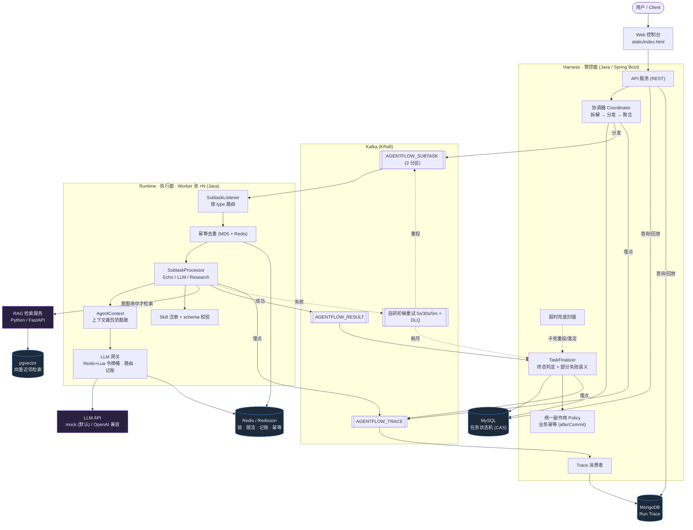

# AgentFlow 架构图

> GitHub 直接渲染 Mermaid;本图与 `docs/specs/2026-07-11-agentflow-design.md` 第 3 节对齐。
> 核心边界:**Harness(管控面)** 负责编排/状态/可靠性/可观测/副作用;**Runtime(执行面)** 只"想和做",
> 一切副作用与持久化回 Harness 经 Policy。

## 系统架构

## 五存储 polyglot persistence(按访问模式选存储)

| 数据 | 访问模式 | 选型 |
|---|---|---|
| 任务状态机 | 事务性状态迁移、按 status/time 扫超时 | **MySQL**(CAS) |
| 任务分发队列 | 持久化日志、分区、消费组、可重放 | **Kafka**(KRaft) |
| 锁/限流/记账/幂等键 | 毫秒读写、TTL、原子操作 | **Redis / Redisson** |
| Run Trace | 嵌套 JSON、写多、按 traceId 整取回放 | **MongoDB** |
| RAG 向量 | 近邻检索(ANN) | **pgvector** |

## 自研核心(简历卖点)

1. **协调器 + 状态机**:DAG 拆解、部分失败语义(`PARTIAL_FAILED`)、CAS 状态迁移、超时兜底。
2. **Kafka 可靠性层**:自研阶梯延迟重试 topic + DLQ + 恢复重放(补齐 Kafka 无原生延迟/死信)。
3. **LLM 网关**:Redis+Lua 令牌桶限流 + 多模型路由 + token 记账,唯一出口收口。
4. **Run Trace**:事件溯源经 Kafka → MongoDB,全链路留痕、可回放审计"闭环执行成功"。
5. **统一副作用 Policy**:所有副作用经同一闸 + 业务幂等 + afterCommit,代码层 enforce。
