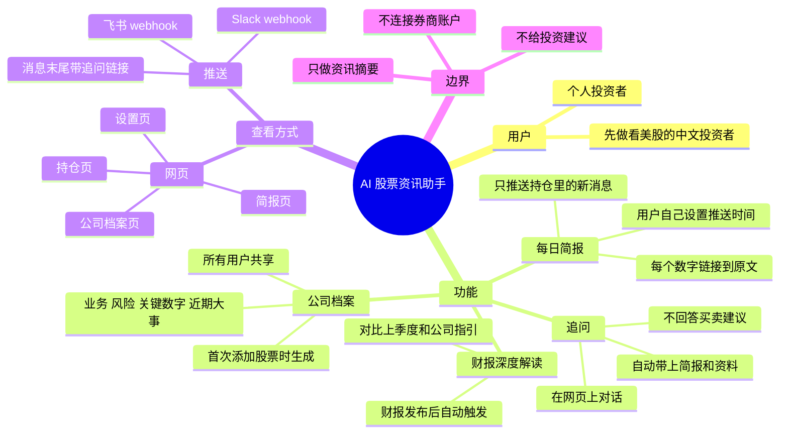
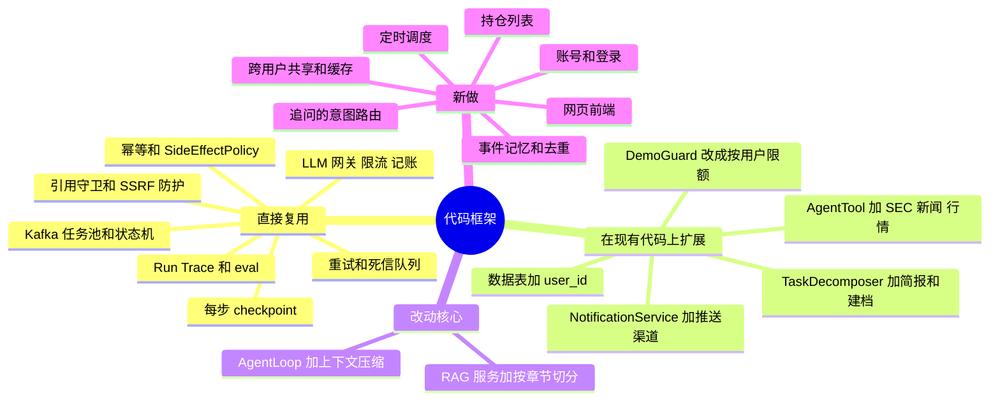
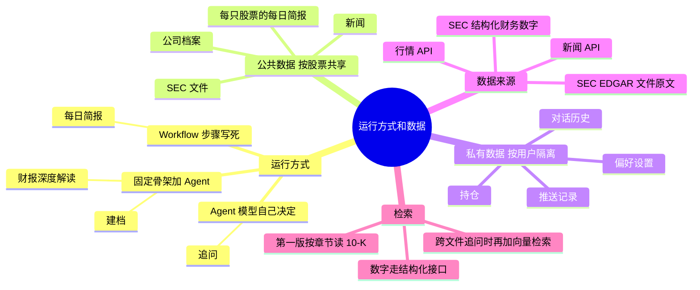
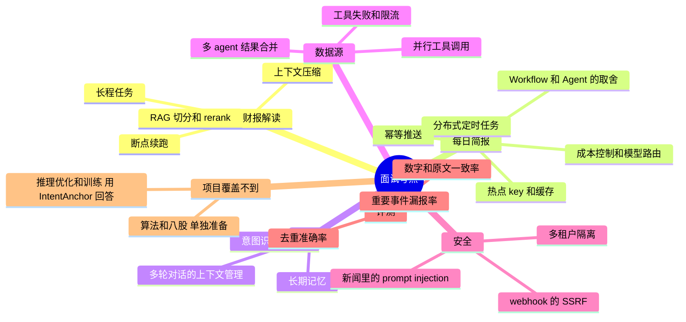
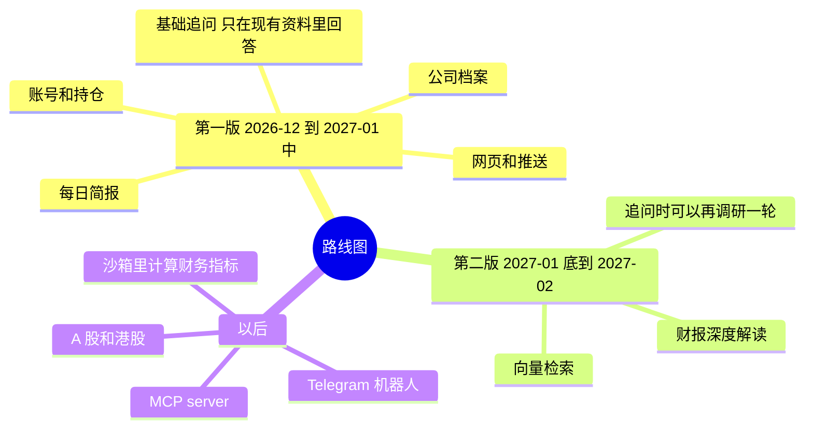

# 产品框架：AI 股票资讯助手（草稿）

> 状态：讨论中，还没有开始开发。更新于 2026-11-09。
> 下面的思维导图用 Mermaid 写成，在 GitHub 上会直接渲染成图。

**一句话**：面向个人投资者的 AI 股票资讯助手。每天只推送持仓里新发生的事，每个数字都能点回原文；可以在网页上看，也可以推送到自己的 Slack、飞书，看完还能追问。

AgentFlow 现有的分布式 agent 引擎作为底层，产品是在它上面新加的一层。

文末列出了哪些决定已经确认、哪些还在等确认。

## 1. 产品

## 2. 代码：哪些复用，哪些新做

## 3. 运行方式和数据

## 4. 面试考点对应到功能

## 5. 路线图

## 已经确认的决定

- 做成公开上线的 ToC 产品，目标用户是个人投资者。
- 场景是每日股票新闻。
- 调研结束后可以追问；追问在网页上进行。
- 用户可以自己设置定时任务。
- 内容可以在网页上看，也可以推送到 Slack、飞书（webhook）。
- 产品要能覆盖 agent 面试里的高频考点。

## 还在等确认的决定

| 决定 | 目前的建议 |
|---|---|
| 先做哪个市场 | 先做美股，面向看美股的中文投资者；数据源做成可插拔，以后接 A 股、港股 |
| 第一版做什么 | 每日简报 + 公司档案；财报深度解读放到第二版，赶 2027 年 1～2 月的财报季 |
| 追问答不了时怎么办 | 第一版直接说"资料里没有"，第二版再支持自动补一轮调研 |
| 持仓填什么 | 只填股票代码，不填数量和成本价，不连接券商账户 |
| 页面有哪些 | 简报页、公司档案页、持仓页、设置页 |
| 代码放哪里 | 继续在本仓库开发，产品对用户另起一个名字 |
| 收费和免费额度 | 未讨论 |
| 部署方式和域名 | 未讨论 |

## 不做的事

- 不给买卖建议，不预测涨跌。追问里问到这类问题直接拒绝。
- 不连接券商账户，不碰用户的资金。
- 不复用 Antalpha 的代码、提示词和数据。
