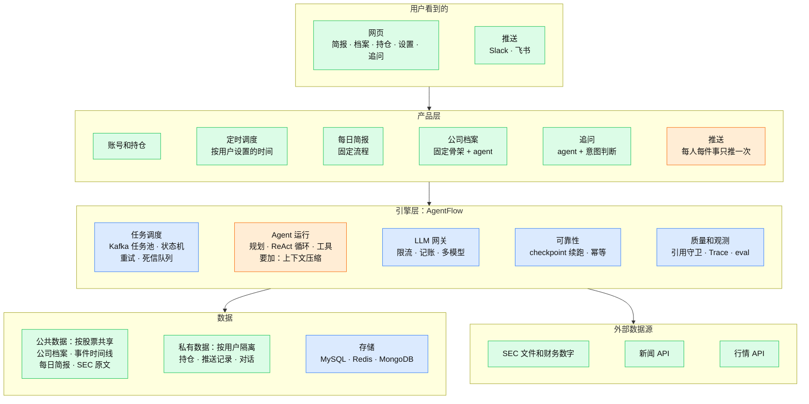
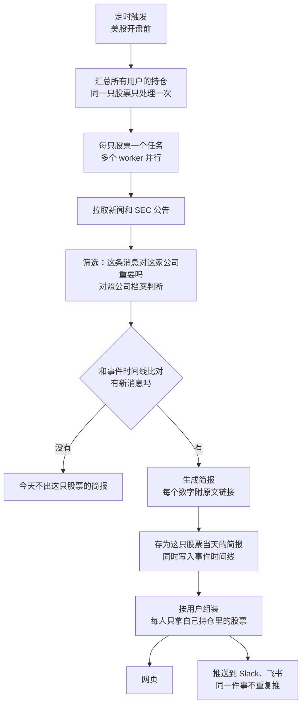
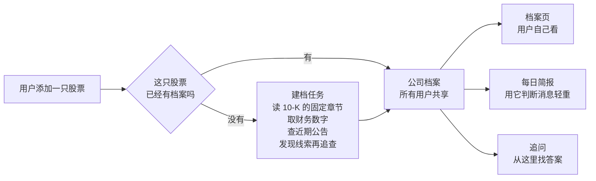
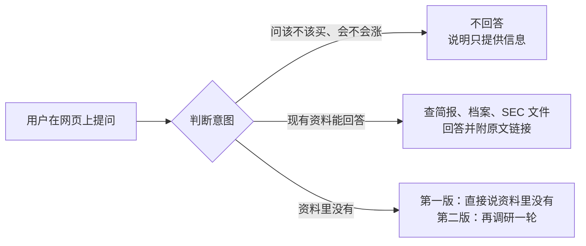

# 产品框架：AI 股票资讯助手（草稿）

> 状态：第一版已经做出来（账号、自选股、每日简报、网页、Slack / 飞书推送），页面在 `/app.html`。公司档案、追问、财报解读还没做。更新于 2026-11-09。
> 下面的图用 Mermaid 写成，在 GitHub 上会直接渲染。

**一句话**：面向个人投资者的 AI 股票资讯助手。每天只推送持仓里新发生的事，每个数字都能点回原文；可以在网页上看，也可以推送到自己的 Slack、飞书，看完还能追问。

AgentFlow 现有的分布式 agent 引擎作为底层，产品是在它上面新加的一层。

文末列出了哪些决定已经确认、哪些还在等确认。图里画的内容包含未确认的建议，以文末清单为准。

## 1. 整体结构

从上到下四层。颜色表示工作量：蓝色是现有代码直接复用，橙色是现有代码要改，绿色是新做。

## 2. 每日简报怎么跑

步骤是固定的，所以用写死的流程，不用 agent。

## 3. 添加股票和建档

建档是第一版里的长程任务：步骤多、文档长，中途崩溃要能从 checkpoint 续跑，上下文太长时要压缩。

## 4. 追问怎么处理

## 5. 每个功能要做什么

| 功能 | 运行方式 | 用到的现有能力 | 要新做的 |
|---|---|---|---|
| 每日简报 | 固定流程 | Kafka 任务池、重试、限流、引用守卫、幂等推送 | 定时调度、新闻和 SEC 数据源、事件时间线和去重 |
| 公司档案 | 固定骨架 + agent | ReAct 循环、checkpoint 续跑 | 上下文压缩、按章节读 10-K、跨用户共享 |
| 追问 | agent | ReAct 循环、引用守卫 | 对话记录、意图判断 |
| 账号和持仓 | 普通业务代码 | 无 | 登录、持仓表、按用户限额（由 DemoGuard 改造） |
| 网页 | 普通前端 | 现有的单页控制台 | 简报页、档案页、持仓页、设置页 |
| 财报深度解读（第二版） | 固定骨架 + agent | 同公司档案 | 财报日历触发、和上季度对比 |

## 6. 路线图

| 阶段 | 时间 | 内容 |
|---|---|---|
| 第一版 | 2026-12 到 2027-01 中 | 账号和持仓、每日简报、公司档案、网页和推送、基础追问（只在现有资料里回答） |
| 第二版 | 2027-01 底到 2027-02 | 财报深度解读、追问时可以再调研一轮、向量检索 |
| 以后 | 未定 | Telegram 机器人、A 股和港股、MCP server、在沙箱里计算财务指标 |

## 7. 面试考点对应到哪个功能

| 考点 | 对应的功能 |
|---|---|
| 长程任务、上下文压缩、断点续跑 | 公司档案、财报深度解读 |
| Workflow 和 agent 的取舍 | 每日简报用固定流程，追问用 agent |
| 分布式定时任务 | 每日简报的定时触发和并行处理 |
| 热点 key 和缓存 | 同一只股票只处理一次，结果给所有关注它的用户 |
| 幂等 | 同一件事对同一个用户只推送一次 |
| 长期记忆 | 事件时间线、用户的对话记录 |
| 意图识别和路由 | 追问 |
| RAG：切分、rerank、什么时候不该用 | 读 SEC 文件；财务数字走结构化接口 |
| 工具失败、限流、并行工具调用 | 新闻和 SEC 数据源 |
| 成本控制和模型路由 | 小模型筛选新闻，大模型写简报和档案 |
| Prompt injection、SSRF、多租户隔离 | 新闻内容、用户填写的 webhook 地址、按用户隔离的私有数据 |
| 评测 | 数字和原文一致率、去重准确率、重要事件漏报率 |

项目覆盖不到的：推理优化和模型训练（用 IntentAnchor 回答），算法和八股（单独准备）。

## 已经确认的决定

- 做成公开上线的 ToC 产品，目标用户是个人投资者。
- 场景是每日股票新闻。
- 调研结束后可以追问；追问在网页上进行。
- 用户可以自己设置定时任务。
- 内容可以在网页上看，也可以推送到 Slack、飞书（webhook）。
- 产品要能覆盖 agent 面试里的高频考点。

## 还在等确认的决定

> 第一版开发时，下面前几行先按「目前的建议」做了（美股、只填代码、继续在本仓库）；公司档案和追问还没做。这些仍然可以改。

| 决定 | 目前的建议 |
|---|---|
| 先做哪个市场 | 先做美股，面向看美股的中文投资者；数据源做成可插拔，以后接 A 股、港股 |
| 第一版做什么 | 每日简报 + 公司档案；财报深度解读放到第二版，赶 2027 年 1～2 月的财报季 |
| 追问答不了时怎么办 | 第一版直接说"资料里没有"，第二版再支持自动补一轮调研 |
| 持仓填什么 | 只填股票代码，不填数量和成本价，不连接券商账户 |
| 页面有哪些 | 简报页、公司档案页、持仓页、设置页 |
| 代码放哪里 | 继续在本仓库开发，产品对用户另起一个名字 |
| 收费和免费额度 | 未讨论 |
| 部署方式和域名 | 未讨论 |

## 不做的事

- 不给买卖建议，不预测涨跌。追问里问到这类问题直接拒绝。
- 不连接券商账户，不碰用户的资金。
- 不复用 Antalpha 的代码、提示词和数据。
